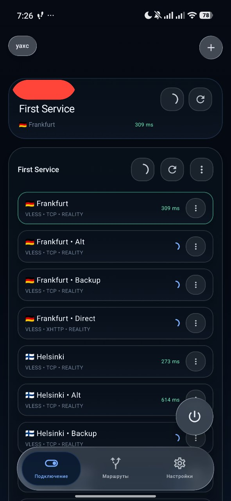
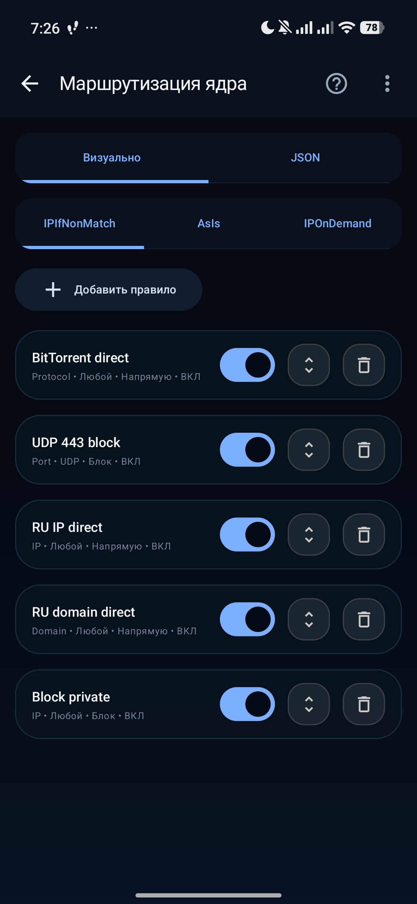
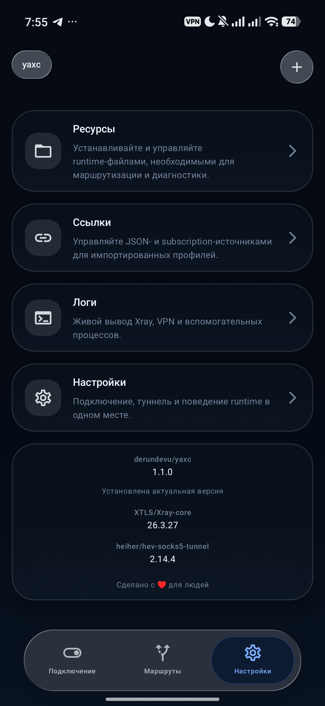

# yaxc

yaxc is an Android client for Xray-core. Manage subscriptions, compare profiles and control how your apps connect.

**Android 8.0+** · [Download APKs](https://github.com/derundevu/yaxc/releases)

Based on [SaeedDev94/Xray](https://github.com/SaeedDev94/Xray); maintained as an independent fork.

## Features

- Import subscriptions and profiles from links, QR codes or the clipboard.
- Keep subscriptions current with automatic refresh.
- Compare profiles with individual and batch latency checks.
- Customize per-app routing and routing rules.
- Edit JSON in a full-screen code workspace with syntax diagnostics, formatting, undo/redo and find/replace.
- View subscription traffic and expiry when provided by your service.
- Choose light or dark themes and manage geodata inside the app.
- Check for app updates without leaving the app.
- Use optional root/transparent-proxy mode for advanced setups.

## Screenshots

## Install and connect

1. Download an APK matching your device from [Releases](https://github.com/derundevu/yaxc/releases).
   Most current phones use `arm64-v8a`.
2. Add a subscription, select a profile and optionally check its latency.
   Use **Scan QR code** or **From Clipboard** to import an HTTPS subscription URL or a profile share link.
3. Download `geoip.dat` and `geosite.dat` in Settings → Resources before connecting:
   the default routing rules use these files.
4. Start the VPN. Routing rules are evaluated in order; higher rules take precedence.

If required geodata is missing, damaged or lacks a referenced group, the connection error identifies the problem.
Use **Resources** to open the relevant file's card, download or import a compatible file, then return and tap **Retry**.
Nothing downloads or connects automatically. Configurations that do not reference geodata do not need these files.

Subscription refreshes are applied as complete updates. Failed or malformed batches keep the previous profiles,
as does cancellation before commit. Mixed valid/invalid batches are rejected rather than silently importing a subset.

Standalone configurations still have known limitations. TUN hardening is experimental and is not a guaranteed kill switch.

## Contributing

Build instructions, CI details and the testing checklist are in the [development guide](docs/DEVELOPMENT.md).

## License

[MIT](LICENSE).
