

  
  <h1>yaxc</h1>
  
<strong>Your Xray profiles. Your routing rules.</strong>

  
An Android client for Xray-core: manage subscriptions, compare servers and choose how your apps connect.

  

    
    
    
  

  

    <a href="https://github.com/derundevu/yaxc/releases"><strong>Download APK</strong></a>
    · <a href="#getting-started">Getting started</a>
    · <a href="#screenshots">Screenshots</a>
    · <a href="#themes">Themes</a>
    · <a href="https://github.com/derundevu/yaxc/issues">Report a bug</a>
  

---

**yaxc is a client, not a VPN service.** Bring a subscription or a compatible server configuration from a provider you trust.
The standard Android VPN mode does **not** require root.

## Features

### Profiles and subscriptions

- Import subscriptions and profile share links from the clipboard or a QR code.
- Keep multiple sources organized alongside your manually created profiles.
- Refresh subscriptions manually or automatically; see traffic usage and expiry when your provider supplies them.
- Check a single profile or compare a group with batch latency checks. Choose HTTP GET, HTTP HEAD or TCP checks.

### Routing you control

- **Per-app split tunneling:** route all apps through the VPN, exclude selected apps or include only selected apps.
- **Core routing:** build ordered rules in the visual editor or edit routing JSON directly. Send matching traffic through the proxy, directly or to a blocking outbound.
- **Live Routing:** combine profiles across subscriptions into proxy groups, then connect using the special Live Routing group without selecting a profile. Route apps or domains and change group choices without reconnecting. See [Live Routing](#live-routing).
- Match domains, IP ranges, ports, protocols and TCP/UDP transport; import and export routing JSON through the clipboard.
- Download or import GeoIP, GeoSite and Antifilter lists in the app. Choose a bundled provider preset or your own geodata URLs.

### Tools for everyday use and advanced setups

- A full-screen JSON editor with syntax diagnostics, formatting, undo/redo and find/replace.
- Connection details and live runtime logs for troubleshooting.
- English and Russian interfaces, system-following appearance and four theme presets, including Mint Graphite and Light Slate.
- In-app release checks and APK updates.
- A Quick Settings tile for connection control, plus optional start on boot.
- Optional root/transparent-proxy settings for advanced hotspot and tethering setups.

## Screenshots

Captured from the **1.5.3 development build** on an isolated Android emulator. All profile names, endpoints and subscription
usage are fictional demo data. These are real app screens, not mockups; the VPN is not connected.

<table>
  <tr>
    <th>Profiles &amp; subscriptions</th>
    <th>Core routing</th>
    <th>Per-app routing</th>
  </tr>
  <tr>
    <td><a href="docs/screenshots/connect.png">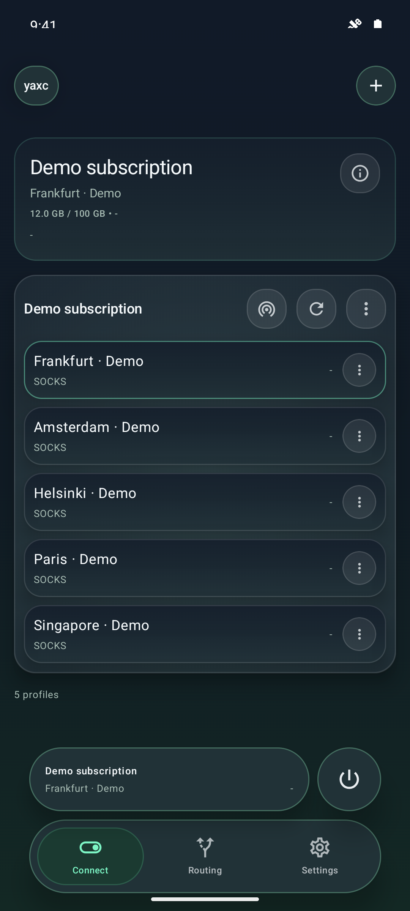</a></td>
    <td><a href="docs/screenshots/core-routing.png">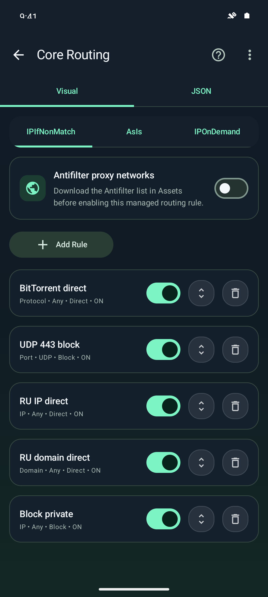</a></td>
    <td><a href="docs/screenshots/apps-routing.png">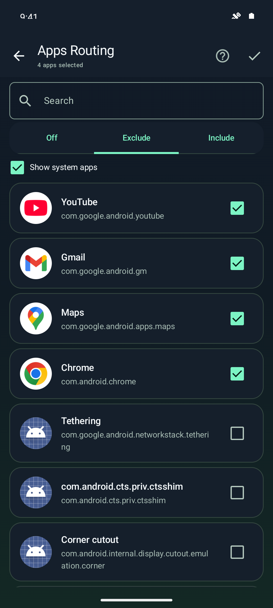</a></td>
  </tr>
  <tr>
    <th>JSON workspace</th>
    <th>Routing resources</th>
    <th>Preferences &amp; themes</th>
  </tr>
  <tr>
    <td><a href="docs/screenshots/json-editor.png">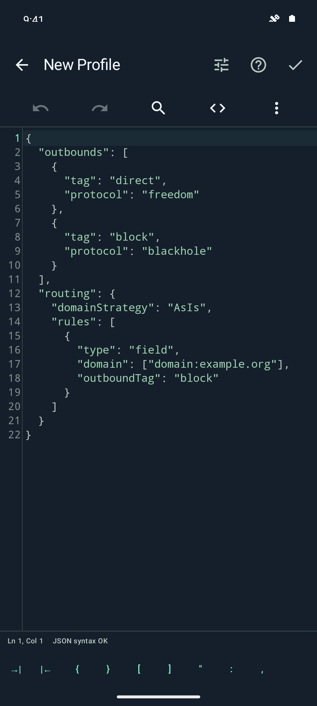</a></td>
    <td><a href="docs/screenshots/resources.png">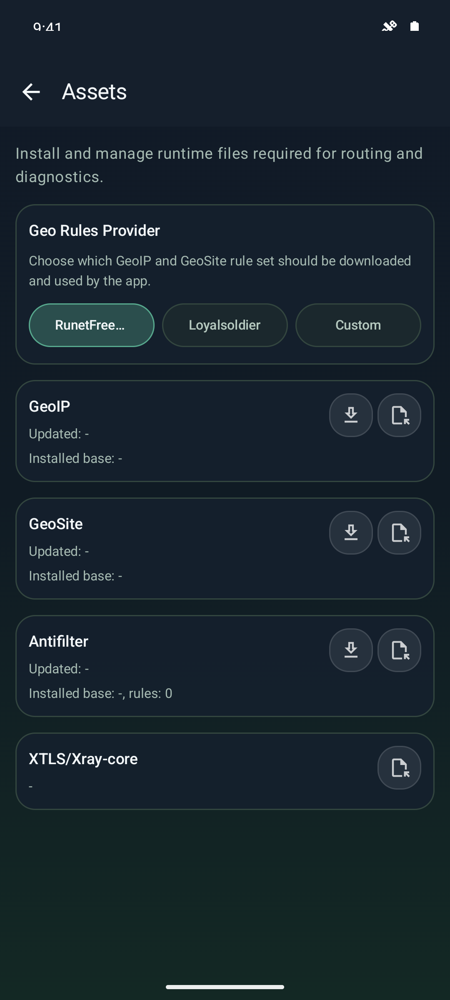</a></td>
    <td><a href="docs/screenshots/preferences.png">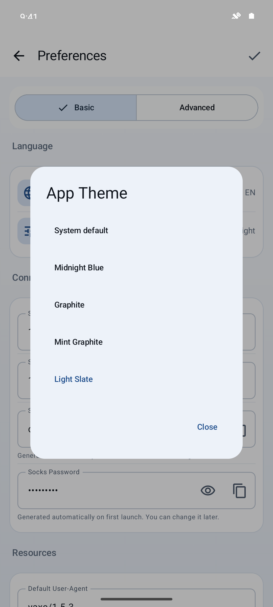</a></td>
  </tr>
</table>

Select any screenshot to view it at full resolution.

### Themes

Choose **Settings → Preferences → Basic → App Theme**, then save. Each preset below shows the same
**Connect** and **Core Routing** screens with identical demo data so you can compare the colors directly.

<table>
  <tr>
    <th>Midnight Blue · Connect</th>
    <th>Midnight Blue · Core Routing</th>
  </tr>
  <tr>
    <td><a href="docs/screenshots/themes/midnight-blue-connect.png">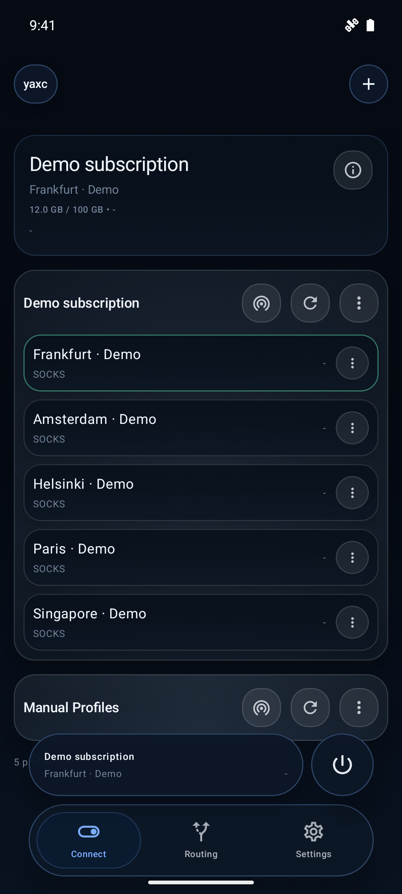</a></td>
    <td></td>
  </tr>
  <tr>
    <th>Graphite · Connect</th>
    <th>Graphite · Core Routing</th>
  </tr>
  <tr>
    <td><a href="docs/screenshots/themes/graphite-connect.png">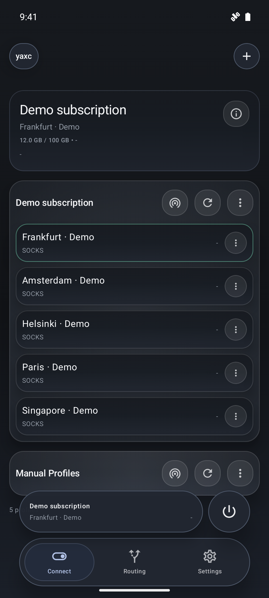</a></td>
    <td><a href="docs/screenshots/themes/graphite-routing.png">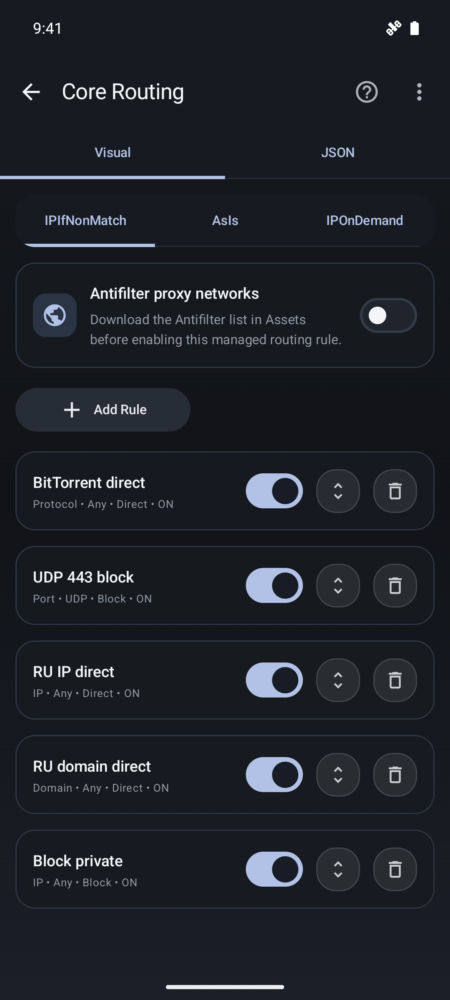</a></td>
  </tr>
  <tr>
    <th>Mint Graphite · Connect</th>
    <th>Mint Graphite · Core Routing</th>
  </tr>
  <tr>
    <td><a href="docs/screenshots/themes/mint-graphite-connect.png">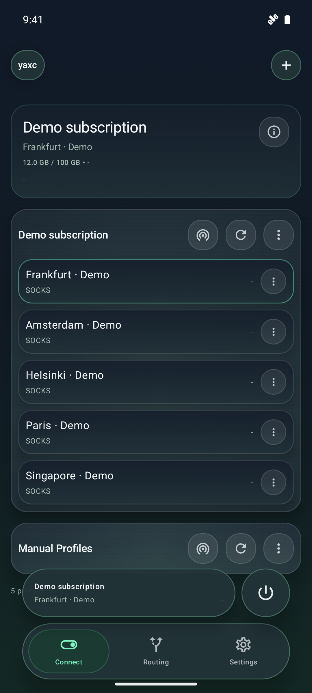</a></td>
    <td><a href="docs/screenshots/themes/mint-graphite-routing.png">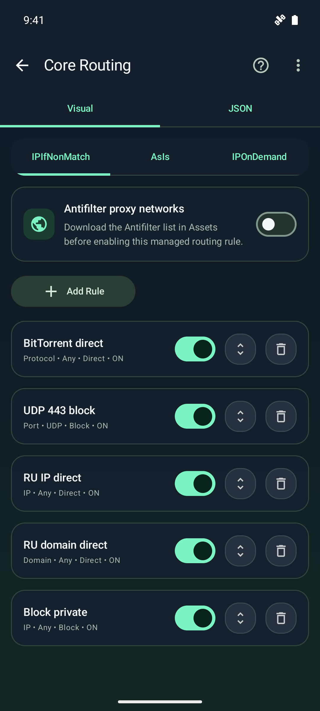</a></td>
  </tr>
  <tr>
    <th>Light Slate · Connect</th>
    <th>Light Slate · Core Routing</th>
  </tr>
  <tr>
    <td><a href="docs/screenshots/themes/light-slate-connect.png">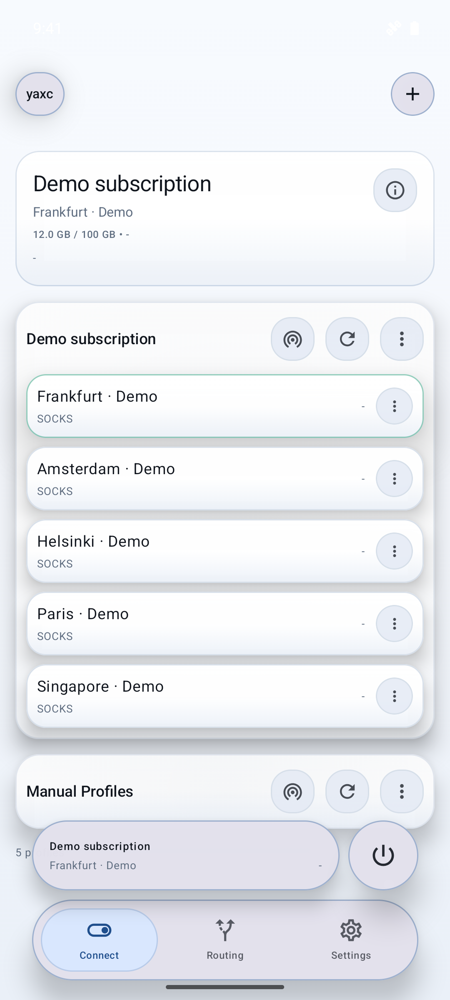</a></td>
    <td><a href="docs/screenshots/themes/light-slate-routing.png">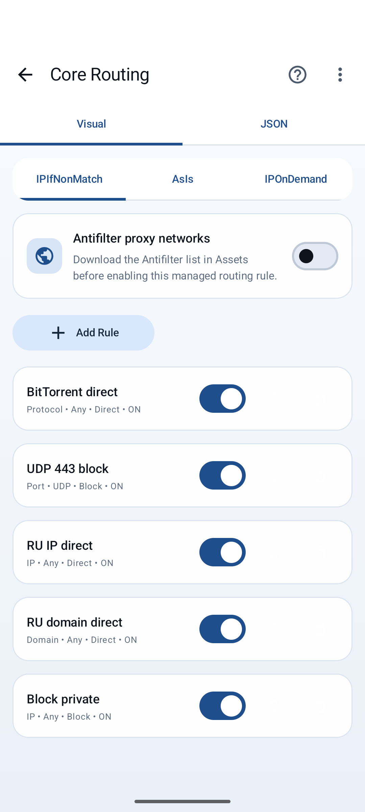</a></td>
  </tr>
</table>

  
<strong>System default — light and dark previews</strong>

  
System default follows Android's appearance: Light Slate in light mode and Midnight Blue in dark mode.
  These captures were taken with <strong>System default</strong> selected and Android switched between the two modes.

  <table>
    <tr>
      <th>System light · Connect</th>
      <th>System light · Core Routing</th>
    </tr>
    <tr>
      <td></td>
      <td></td>
    </tr>
    <tr>
      <th>System dark · Connect</th>
      <th>System dark · Core Routing</th>
    </tr>
    <tr>
      <td></td>
      <td><a href="docs/screenshots/themes/system-dark-routing.png">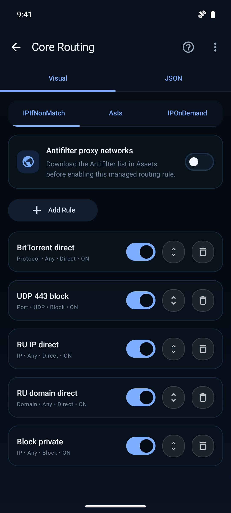</a></td>
    </tr>
  </table>

## Download

Download APKs from [GitHub Releases](https://github.com/derundevu/yaxc/releases). Requires **Android 8.0 or newer**.

| APK | Choose this for |
| --- | --- |
| `universal` | Any supported architecture; the simplest choice if you are unsure. Available starting with **1.5.3**. |
| `arm64-v8a` | Most current Android phones and tablets; smaller than universal. |
| `armeabi-v7a` | Older devices running 32-bit ARM Android. |
| `x86_64` | Devices and emulators running 64-bit x86 Android. |
| `x86` | Devices and emulators running 32-bit x86 Android. |

Allow your browser or file manager to install apps from this source if Android asks.
When updating, install over the existing app using the same signing source to keep your profiles and preferences.
If Android reports a signing conflict, do not uninstall just to bypass it: uninstalling removes app data.

## Getting started

1. **Install yaxc** using the APK for your device.
2. **Add your configuration.** Copy an HTTPS subscription URL or a supported profile share link, then use **From Clipboard**
   on the Connect screen. You can also use **Scan QR code**, or create a manual group and a JSON profile.
3. **Prepare routing resources.** Open **Settings → Assets** and download `geoip.dat` and `geosite.dat` for the default
   routing rules. Configurations without geodata references do not need these files.
4. **Choose a profile.** Open its group, select a server and optionally run a latency check.
5. **Connect.** Tap the power button and approve Android's VPN request. Use the same button to disconnect.

For split tunneling, open **Routing → Apps Routing**, choose **Off**, **Exclude** or **Include**, select apps and save.
Selected apps stay at the top. **Select all visible apps** checks every app matching the current search and system-app
filter; tap it again to clear those matches. Selections hidden by the filters are left unchanged.

For domain/IP rules, open **Routing → Core Routing**. Rules are evaluated from top to bottom; higher rules take precedence.

### Live Routing

**Subscription safety:** disable **Settings → Preferences → Auto-refresh subscriptions** and refresh manually.
Profile IDs are matched by position, not permanent server identity: a provider reordering entries can silently put
a different server into an existing group. **Do not use Live Routing with subscriptions returned in random order.**
Manual refresh does not fix randomized ordering. Review membership, endpoints and priorities after each refresh.
An active session can apply a manual refresh immediately; stop Live Routing first if you need to inspect changes
before using them, then review and reconnect.

Open **Routing → Live Routing**:

1. Choose **Add proxy group**, give it a name and choose member profiles from any subscription or local profiles.
2. Choose a strategy: **Select** uses the configured member; **Random** chooses a member per new connection;
   **Round robin** cycles through members per new connection.
3. Optionally enable **Consider node availability**. Select then uses the first healthy member in the explicit
   **Primary and backup order**; Random/Round robin keep distributing connections among all healthy members.
   This option is off for old and new groups until you enable it.
4. Choose the **default group** for unmatched traffic. The first group is used automatically until you choose another.
   Reordering groups changes this automatic fallback; an explicitly chosen default group stays selected.
5. Add an ordered rule, choose apps and/or enter domains, then choose a group, **Default route**, **Direct** or **Block**.
   Long-press a group or rule header and drag to reorder within its section; disabled rules do not match.
6. Tap **Save**. This persists the plan locally and requests a live update if a session is active; it does not connect
   a stopped session. A local save is not confirmation that the running core accepted it: check **Connect** for errors.
7. On **Connect**, select the special **Live Routing** group and tap the usual connection button. No individual
   profile needs to be selected. Ordinary subscription groups and profile selection remain available.

Use **?** beside **Save** for the full setup guide, examples, subscription warnings and routing limitations.

Tap a group or rule header to expand or collapse its editor; new entries open automatically. Collapsing keeps your
unsaved fields and text selection. For offscreen positions, scroll and drag again or use the arrows in the expanded
card. Selected apps appear first in the app picker; **Select all visible apps** affects only the current search results
and leaves hidden selections untouched.

The first matching enabled rule wins, before **Core Routing**. When a rule contains both apps and domains, **both**
criteria must match (AND); any value within either list is enough (OR). After Core Routing, unmatched traffic uses
the default group's strategy in a Live Routing connection. **Default route** and Core Routing proxy targets also use
that group; explicit direct/block routes keep their meaning. With a regular profile selected, these rules remain an
overlay and the selected profile supplies the default route. Domain entries are one per line: a bare hostname such as `example.com` or
`domain:example.com` matches that domain and its subdomains; `full:example.com` is exact. `regexp:`, `geosite:` and
`ext:<file>:<tag>` matchers are also supported. Hostnames are normalized to ASCII for internationalized domains.
Xray must know the destination hostname from the proxy request or sniffing; an IP-only connection may not match.

Groups compose each member's outbound graph, including supported outbound chains, rather than switching whole
configurations. A Live Routing connection uses the app's global DNS, inbound and Core Routing settings, not one
member's full configuration. A regular profile connection still shares those settings with the selected profile.
Unsupported or incomplete graphs are rejected; missing members or an invalid default-group choice are never silently
replaced. All group members stay loaded, so changing the default group, selected member or strategy alone does not
allocate new native handlers.

Availability checks perform an HTTP GET to the existing **Ping Address** setting through each member's complete
outbound graph, not a direct server-port test. The URL must be HTTP(S); only 2xx succeeds and redirects are not
followed. The manual ping type/timeout do not change these background checks.

- Checks start immediately, then every **10 seconds per member** when a worker is available; timeout **5 seconds**,
  at most **4 concurrent probes** across all groups. Large groups can queue.
- An untested member is **checking**, not healthy. Its first success admits it; **2 consecutive failures** remove
  it, and **3 consecutive successes** restore it. Observations older than **35 seconds** expire to checking and
  need three successes again. Endpoint/graph or probe-URL changes cannot inherit old observations.
- Without queueing, failure detection is approximately **10–25 seconds**; recovery is approximately **20–35 seconds**
  after service returns. The UI refreshes status about once a second. These are not user-request timeouts.
- Select returns new connections to the highest-priority eligible node. Random/Round robin have multiple eligible
  participants, not one active node. The editor distinguishes configured primary, actual runtime choice and unsaved
  or outdated configuration.
- With checks enabled, **no eligible member means rejection of new group traffic**, including during startup or a
  controller error. It never escapes through the ordinary profile, another group, default outbound or direct route.
  This also applies when that group is the independent default or is reached through Default route/Core Routing.

The check proves only this HTTP request through that graph at that time, not every site, DNS request or TCP/UDP
protocol. A broken probe endpoint can mark otherwise usable members unavailable; choose an endpoint suitable for
your network. Checks consume network traffic and battery while the core is running.

Accepted changes affect **new flows** without restarting Xray or the TUN, changing the selected connection or
interrupting established streams. Validation/live-update errors keep the previous runtime. Endpoint or graph changes
can consume a session's native handler-version budget (512, including the initial handlers); if it is exhausted,
the update is rejected with an explicit reconnect request, never an automatic reconnect.

**Limitations:** app matching requires **VPN mode on Android 10+ and authenticated SOCKS**. Apps sharing an Android
UID cannot be distinguished; an unknown connection owner does not match app criteria. **Apps Routing** still decides
which apps enter the VPN, so excluded apps bypass Live Routing too. Domain-only rules also work in SOCKS-only mode.
Live Routing is explicitly unavailable in root transparent mode; saving there is disabled.
Keep the default **Socks UDP** setting enabled: disabling it selects a legacy UDP-over-TCP protocol that the bundled
Xray core does not support.

Per-app rules are routing preferences, not an authorization boundary for clients that know your SOCKS password.
Keep those credentials private: a direct SOCKS client with the password can choose a managed app identity.

## Subscription updates

Automatic refresh is optional. Enable **Settings → Preferences → Auto-refresh subscriptions** and set the refresh interval;
provider-supplied intervals are used when available. Android may defer background work.

For Live Routing, keep automatic refresh **off** and inspect explicit updates. Positional profile IDs mean reordering,
insertion or deletion can change which server a retained group member represents. Randomized provider ordering is
not supported safely, even with manual refresh or availability checks.

Each source is updated as a complete batch: a failed or malformed refresh keeps that source's previous profiles.
Cancellation before commit also keeps them; an update already committing finishes before reporting its result.
An unchanged active configuration keeps the connection running. Validated routing/outbound-only changes can also
apply live, retaining established streams, when shared core and platform settings are unchanged. Other validated
core changes reload Xray; changed VPN/platform settings require a restart. Invalid candidates or rejected live
updates keep the previous runtime and report an error; a reconnect-required rejection never forces a reconnect.
If conditional subscription reconciliation (`NEW_CONFIG`) finds that the selected default profile was removed, it
stops the runtime rather than silently selecting another profile. A missing Live Routing group member instead rejects
the update without substituting a member. When refreshing multiple sources, successful sources can still update;
the result reports any partial failures.

## FAQ

### Does yaxc include servers or a subscription?

No. You need your own compatible configuration or an HTTPS subscription from a provider.
Availability, speed and server-side privacy depend on that provider and your network.

### Which configuration formats can I use?

Use Xray JSON configurations or supported profile share links, including VLESS. You can also open a local JSON file with yaxc.
Subscription sources can provide raw JSON or supported share-link lists, including base64-encoded subscriptions.
A feature supported by Xray-core is not necessarily available through every share-link format.

### Why does the connection ask for GeoIP or GeoSite?

A routing rule references `geoip.dat`, `geosite.dat` or a group inside one of those files.
On the error dialog, choose **Resources**, download or import a compatible file, then return and tap **Retry**.
If a group is missing, choose a rule set containing it or change the rule. Recovery does not automatically download files or connect.

### Do I need root? Can this replace a kill switch?

Normal VPN use does not require root. Transparent-proxy mode is an advanced, root-dependent path and requires a separately
installed Xray executable in **Assets**. Root/iptables behavior varies by device and is not as broadly verified as VPN mode.

Experimental TUN protection is **not a guaranteed kill switch**. Do not rely on yaxc to prevent every possible traffic leak.

### What information is sent over the network?

Subscription requests go to your provider and can include the configured **User-Agent**, **x-hwid** identifier and Android/device
headers. Review global values in **Preferences** and per-source overrides in **Links**.
Release checks contact GitHub; resource downloads and latency checks contact their configured endpoints.
Treat subscription URLs and exported configurations as secrets, and choose providers you trust.

### What should I include in a bug report?

Open an [issue](https://github.com/derundevu/yaxc/issues) with your app version, Android version, device model,
steps to reproduce and the relevant error or log excerpt. Note whether you use VPN or root mode.
**Redact subscription URLs and tokens, server addresses, UUIDs, passwords, keys and local proxy credentials** before sharing logs,
JSON or screenshots.

## Contributing

Bug reports, reproducible examples and focused pull requests are welcome.
Build instructions, native dependency details and verification workflows live in the
[development guide](docs/DEVELOPMENT.md), not in this user guide.

## Credits and license

yaxc is an independently maintained fork of [SaeedDev94/Xray](https://github.com/SaeedDev94/Xray),
powered by [Xray-core](https://github.com/XTLS/Xray-core) and [hev-socks5-tunnel](https://github.com/heiher/hev-socks5-tunnel).

The app is licensed under [MIT](LICENSE). Bundled third-party components retain their respective licenses.
